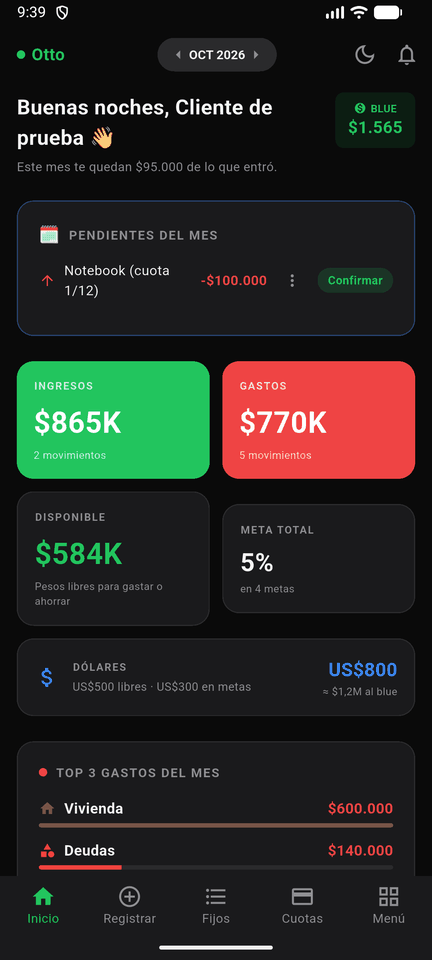
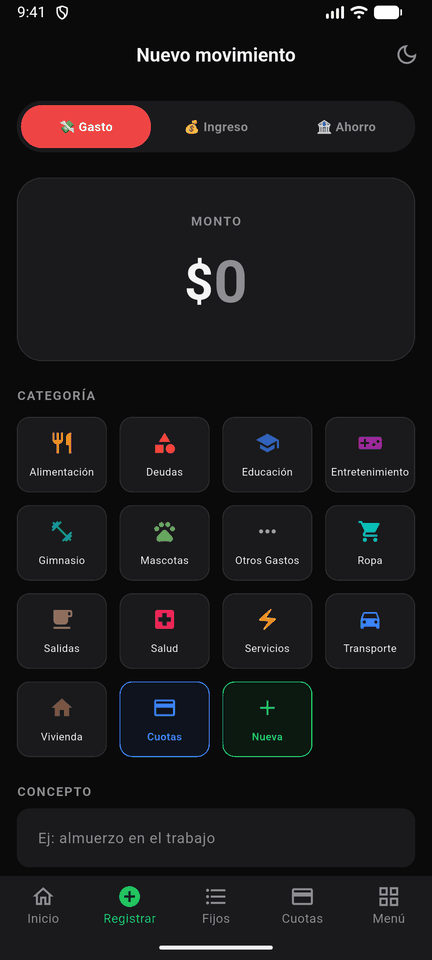
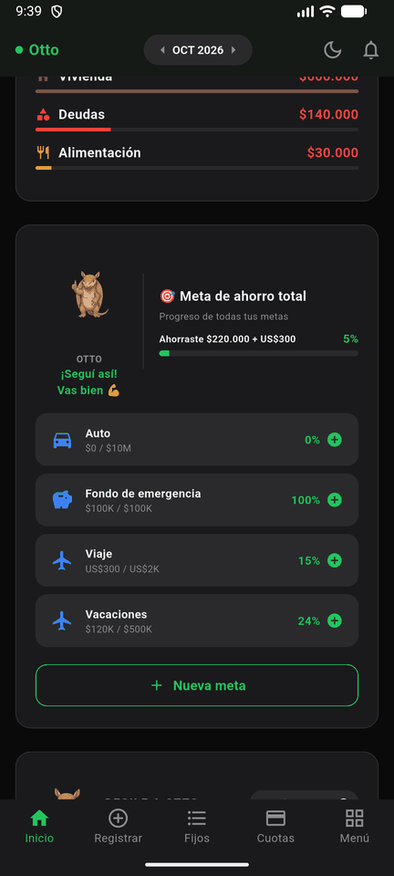
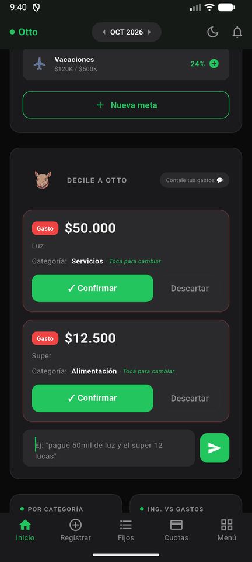

# Otto

Gestor de finanzas personales para Android, hecho en Flutter para un cliente
que lo usa todos los días. Registra gastos e ingresos, metas de ahorro en pesos
y en dólares, gastos fijos, compras en cuotas y el sueldo, y tiene un chat
("Decile a Otto") que entiende mensajes como *"pagué 50 lucas de luz y el
super 12 mil"*.

| Inicio | Registrar | Metas | Chat con Otto |
|---|---|---|---|
|  |  |  |  |

> Las capturas usan datos inventados (la base de prueba de los tests).

## Qué hace

- **Disponible en pesos**: la plata libre es el saldo de una cuenta del libro,
  así que no cambia cuando se mueve el dólar. Los dólares (ahorro previo y
  metas en USD) se muestran aparte, estimados al blue del día.
- **Metas de ahorro** en pesos o en dólares: aportar, retirar y mover entre
  metas. Cada operación es una transferencia que queda en el historial.
- **Sueldo, gastos fijos y cuotas** como planes: cada mes aparecen como
  pendientes para confirmar, sin duplicarse aunque se toque dos veces.
- **Presupuestos por categoría** con alerta amarilla al 80% y roja al 100%.
- **Chat con Otto**: interpreta varios movimientos por mensaje con IA (o con un
  parser local si la IA está apagada) y los registra con el mismo servicio que
  el formulario.
- **Resumen del mes** con una devolución de Otto "contador".
- Respaldo en JSON, bloqueo con huella o PIN, recordatorios diarios y modo
  claro/oscuro.

## Arquitectura

```
lib/
├── core/
│   ├── base_de_datos/   esquema v9, migración v8 → v9 y apertura de la base
│   ├── libro/           ServicioLibro (escrituras), consultas y modelos
│   ├── dinero/          tipo Dinero (centavos + moneda), parser y formato es_AR
│   ├── seguridad/       bloqueo biométrico y FLAG_SECURE
│   └── ui/              tema y widgets compartidos
└── features/            una carpeta por funcionalidad
    ├── movimientos/     formulario y listas
    ├── panel_control/   inicio, metas, estadísticas, resumen
    ├── recurrentes/     planes (sueldo, fijos, cuotas) y pendientes
    ├── categorias/      categorías y presupuestos
    ├── otto/            chat e IA
    └── configuracion/   ajustes, respaldo y notificaciones
```

- **Feature-first** con Riverpod (codegen) para el estado y sqflite para los
  datos.
- **Un libro único**: todos los movimientos son filas de `movimientos` entre
  cuentas (`Libre ARS`, `Dólares` y una cuenta por meta). Ingresos y gastos
  llevan categoría; aportes, retiros y movimientos entre metas son
  transferencias, con `monto_destino` cuando cambia la moneda. El saldo de
  cada cuenta sale de una vista SQL (`saldos_cuentas`); no hay saldos
  guardados aparte que puedan desincronizarse.
- **Un solo camino de escritura**: `ServicioLibro` recibe un
  `DatabaseExecutor` (base o transacción), valida contra el saldo dentro de la
  misma transacción y lo usan el formulario, el chat, los pendientes y las
  metas.
- **Planes idempotentes**: `plan_aplicaciones` tiene clave primaria
  `(plan_id, periodo)`; confirmar un mes es `INSERT OR IGNORE` más el gasto en
  la misma transacción. Las cuotas pagadas se cuentan desde esas filas y
  borrar el gasto generado libera el mes.
- **Dinero en centavos** (`INTEGER`) y sumas en SQL. Un solo parser es_AR para
  todo lo que escribe el usuario o devuelve la IA.

### Migración de la base del cliente

El cliente tenía datos en el esquema anterior (v8). La migración a v9:

1. copia el archivo `.db` antes de tocarlo;
2. corre en la transacción de apertura: renombra las tablas viejas, crea las
   nuevas y pasa movimientos, aportes, fijos, cuotas y sueldo;
3. **antes del COMMIT** compara el disponible en pesos, el saldo de cada meta,
   los totales y las cuotas pagadas con lo que había en v8; si algo no cierra,
   se revierte todo y la app muestra una pantalla para compartir la copia.

Está probada con una base v8 sintética (`test/soporte/base_v8.dart`) que
incluye los casos raros de producción: pendientes duplicados por doble toque,
aportes anteriores a v8 sin registrar y movimientos borrados.

## Correrla

Probado con Flutter 3.44 en Android 16 (emulador y teléfono). Necesita un
dispositivo o emulador Android.

```bash
flutter pub get
flutter run
```

Sin más configuración la app funciona completa, salvo la IA: el chat usa el
parser local y el resumen no pide la devolución del contador.

### Con IA

La clave de Pollinations **no** está en la app: vive en un proxy mínimo
(Cloudflare Worker, en [`proxy/`](proxy/README.md)) que la agrega y limita el
uso. Con el proxy desplegado:

```bash
cp env.example.json env.json   # completar OTTO_IA_URL (y OTTO_IA_TOKEN si se usa)
flutter run --dart-define-from-file=env.json
```

### Tests

```bash
flutter test
```

Cubren el tipo `Dinero`, la migración v8 → v9 contra la base de prueba
(saldos, sumas por mes, cuotas, rollback y reapertura), el servicio del libro,
los planes (incluidas dos confirmaciones simultáneas), el respaldo y el
bloqueo biométrico.

### Firma del APK

El release se firma con un keystore propio. Crear uno (una sola vez, y
guardarlo fuera del repo):

```bash
keytool -genkey -v -keystore ~/otto-release.jks -keyalg RSA -keysize 2048 -validity 10000 -alias otto
```

y un `android/key.properties` (está en `.gitignore`):

```properties
storeFile=C:/ruta/a/otto-release.jks
storePassword=...
keyAlias=otto
keyPassword=...
```

Sin ese archivo, `flutter build apk --release` falla a propósito. Para pasar
al cliente de la versión anterior, ver
[`docs/migracion-cliente.md`](docs/migracion-cliente.md).

## Privacidad

Los datos viven en una base SQLite en el teléfono y no van al backup de Google
(el respaldo es el JSON que exporta el usuario). **Con la IA activada**, el
chat envía el texto del mensaje y la lista de categorías, y el resumen del mes
envía los totales por categoría, el sobrante y el avance de las metas, a un
servicio externo (Pollinations, a través del proxy). La IA se apaga en Menú →
Privacidad y seguridad; el resumen se guarda por mes para no repetir llamadas.

## Limitaciones conocidas

- **Solo Android.** iOS no está configurado.
- El blue se toma de [DolarApi](https://dolarapi.com); sin red se usa la última
  cotización guardada.
- El proxy de IA limita pedidos por IP, pero cualquiera con la URL puede
  usarlo dentro de ese límite; conviene ponerle un tope de gasto a la clave.
- Los avisos de gastos fijos usan alarmas inexactas: pueden llegar con unos
  minutos de diferencia.
- El nombre de la categoría "Horas extras" define que el monto se carga en
  horas; si se renombra, deja de comportarse así.

## Licencia

[MIT](LICENSE). El código se publica con permiso del cliente; los datos de las
capturas y de los tests son inventados.
